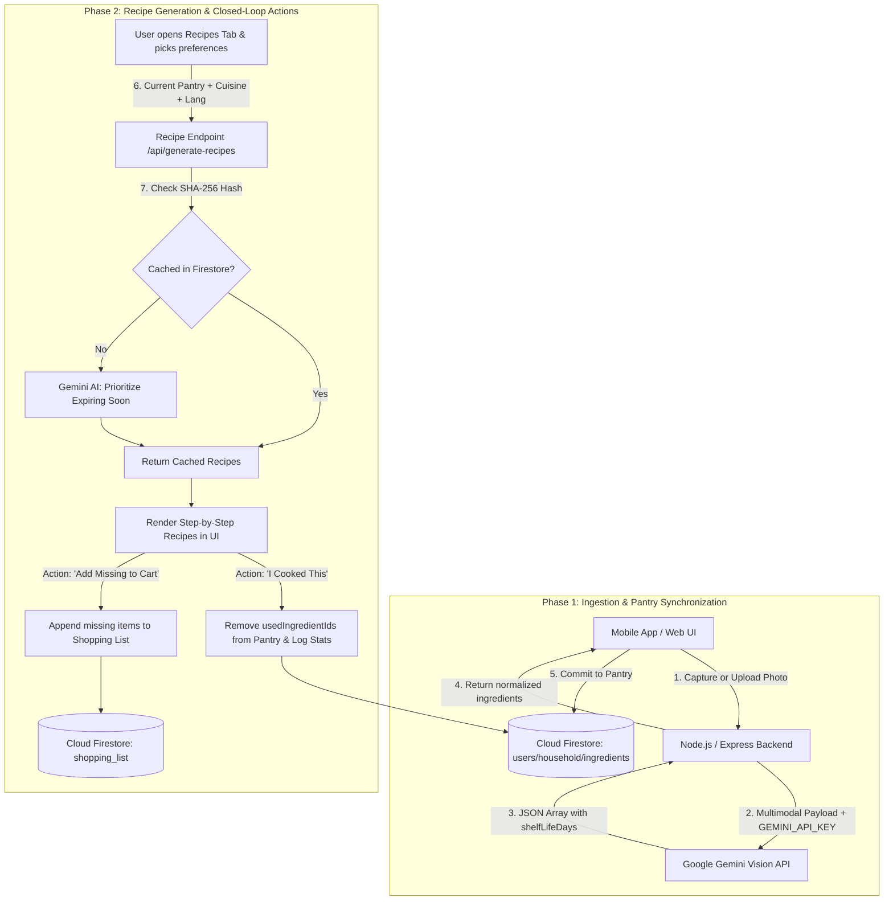

# FreshPlate Architecture & Workflow Specification

This document details the exact end-to-end operational workflow of **FreshPlate** and highlights how it compares to a traditional single-pass vision pipeline.

---

## 1. High-Level Comparison

### Proposed Diagram (Direct 1-Shot Pipeline)
```text
[ Mobile App ] ──(1) Upload image──> [ Backend ] ──(2) Prompt──> [ Gemini Vision ] ──(3) Ingredients──> [ Recipe Engine ] ──(4) Recipes──> [ Mobile UI ]
```

### What is Different in FreshPlate?
In the proposed pipeline, uploading a photo immediately and directly generates a recipe on the spot. In FreshPlate, the architecture is **decoupled into two distinct, stateful phases**:

1. **Phase 1: Ingestion & Pantry Management (Pantry Engine)**
   - Uploading an image or receipt does **not** directly generate recipes.
   - Instead, Gemini Vision extracts ingredients and calculates **shelf life and expiration dates**.
   - These ingredients are committed to the **Pantry / Cloud Firestore**, tracking freshness (`fresh`, `expiring_soon`, `expired`).
   - The app also supports 3 other ingestion channels: **Gmail auto-receipt sync**, **quick-commerce text paste**, and **manual entry**.

2. **Phase 2: On-Demand Expiry-Prioritized Recipe Generation (Culinary Engine)**
   - Triggered on-demand when the user visits the **Recipes** view.
   - It takes the **entire active pantry**, custom preferences (Cuisine, English/Hindi/Hinglish, Adult/Child portions), and checks a **SHA-256 Firestore recipe cache**.
   - Gemini AI prioritizes items **expiring soonest** to prevent food waste.
   - It outputs `usedIngredientIds` and `missingIngredients`.

3. **Closed Feedback Loop:**
   - **"I Cooked This"**: Automatically deducts the used ingredients from the user's pantry in Firestore and updates household sustainability analytics.
   - **"Add Missing to Cart"**: Automatically appends missing ingredients to the user's **Shopping List**.

---

## 2. Complete Workflow Diagram

```text
===================================================================================================
                                PHASE 1: INGESTION & PANTRY STATE
===================================================================================================

[ Mobile App (Camera / Gallery / Receipt) ]
                   │
                   │ (1) POST /api/parse-image { imageBase64, mimeType }
                   ▼
       [ Express / Node.js Backend ] ──── Holds GEMINI_API_KEY
                   │
                   │ (2) Multimodal Structured Prompt (inlineData)
                   ▼
      [ Google Gemini Vision API ] ──── Model: gemini-3.6-flash
                   │
                   │ (3) Structured JSON [{ name, category, quantity, shelfLifeDays }]
                   ▼
       [ Express / Node.js Backend ] ──── Calculates estimatedExpiryDate = today + shelfLifeDays
                   │
                   │ (4) Returns { ingredients: [...] }
                   ▼
     [ User's Active Pantry (State) ] ──── Synced to Cloud Firestore (users/{id}/ingredients)
                                            Tracks freshness: Fresh, Expiring Soon, Expired

===================================================================================================
                        PHASE 2: ON-DEMAND EXPIRY-AWARE RECIPE ENGINE
===================================================================================================

[ Mobile App (Recipes Tab) ]
   User selects: Cuisine (Italian/Mexican/Indian), Language (EN/HI/Hinglish), Servings
                   │
                   │ (5) POST /api/generate-recipes { ingredients, cuisine, language, adults, children }
                   ▼
       [ Express / Node.js Backend ]
                   │
                   ├──> [ Smart Cache Check ] (SHA-256 hash in Firestore `recipe_cache`)
                   │         │ (If cached: returns instant recipes)
                   │         ▼
                   │    (If cache miss)
                   │
                   │ (6) Prompt with Urgent Expiring Items + Other Fresh Items
                   ▼
       [ Google Gemini AI Engine ]
                   │
                   │ (7) Structured Recipe Suggestions:
                   │     - title, description, instructions
                   │     - usedIngredientIds (Pantry items used)
                   │     - missingIngredients (Pantry items lacking)
                   ▼
     [ Mobile UI: Interactive Recipes ]
                   │
        ┌──────────┴──────────────────────────────────────┐
        │                                                 │
        ▼ (Action A: "I Cooked This")                     ▼ (Action B: "Add Missing to Cart")
 [ Deduct usedIngredientIds from Pantry ]          [ Append missing ingredients to Cart ]
 [ Update Consumption Analytics in DB   ]          [ Synced to Shopping List in DB      ]
```

---

## 3. Mermaid Flowchart



---

## 4. Step-by-Step Technical Details

### Phase 1: Vision Ingestion (`POST /api/parse-image`)
* **Endpoint:** `/api/parse-image` in `server.ts`
* **Model:** `gemini-3.6-flash` (with automated fallback retry to `gemini-3.5-flash`)
* **Input Payload:**
  ```json
  {
    "imageBase64": "<base64_string>",
    "mimeType": "image/jpeg"
  }
  ```
* **Gemini Output:**
  ```json
  [
    {
      "name": "Tomatoes",
      "category": "Vegetables",
      "quantity": "500g",
      "shelfLifeDays": 5
    }
  ]
  ```
* **Storage:** Backend transforms `shelfLifeDays` into an ISO string `estimatedExpiryDate = new Date() + shelfLifeDays` and sends it to the frontend, which syncs directly with Firebase Firestore.

### Phase 2: Recipe Generation (`POST /api/generate-recipes`)
* **Endpoint:** `/api/generate-recipes` in `server.ts`
* **Input Payload:**
  ```json
  {
    "ingredients": [ ... ],
    "cuisine": "Mexican",
    "language": "English",
    "adults": 2,
    "children": 0
  }
  ```
* **Smart Waste-Reduction Logic:**
  - Separates pantry items into `expiringItems` (`expiring_soon` / `stale`) and `freshItems`.
  - Prompts Gemini to **prioritize expiring items** so perishable food is used before spoiling.
  - Automatically handles multi-lingual instruction output (English, Hindi, Hinglish).
* **Return Payload:**
  ```json
  {
    "recipes": [
      {
        "title": "Roasted Tomato Salsa & Chicken Tacos",
        "description": "Quick weeknight tacos using up ripe tomatoes.",
        "ingredients": ["Tomatoes", "Chicken Breast", "Taco Shells"],
        "instructions": ["Step 1...", "Step 2..."],
        "prepTime": "10 mins",
        "cookTime": "15 mins",
        "difficulty": "Easy",
        "matchesExpiring": true,
        "usedIngredientIds": ["id_tomato_123"],
        "missingIngredients": ["Taco Shells"]
      }
    ]
  }
  ```

---

## 5. Summary of Key Enhancements in FreshPlate

1. **Stateful Pantry Storage:** Items are stored and monitored over time, rather than lost after a single recipe calculation.
2. **Waste-First Prioritization:** The recipe engine explicitly prioritizes items close to expiration.
3. **Multi-Channel Ingestion:** Besides Camera Vision, users can import via Gmail receipt scanning, delivery app text parsing, or manual input.
4. **Interactive Actions:** Users can mark recipes as cooked (deducting inventory) or export missing ingredients directly into their shopping cart.
